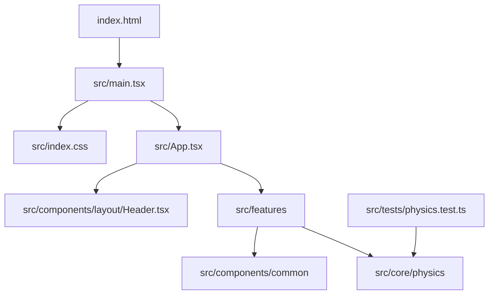

# Explicação completa do código

## 1. Escopo e estado real

O Quantum Lab é uma SPA React/TypeScript para explorar seis modelos
introdutórios de mecânica quântica. A aplicação atual é um laboratório
educacional de física quântica; matemática geral, física clássica, física
moderna não quântica e métodos numéricos ainda são extensões futuras, não
funcionalidades implementadas.

Esta documentação foi escrita a partir dos arquivos-fonte rastreados em
`src/`, das configurações da raiz, do workflow em `.github/` e da documentação
existente. `node_modules/` e `dist/` são artefatos gerados e não fazem parte do
mapa funcional.

Não há código Python no repositório. Portanto, não existe `requirements.txt`:
as dependências reais são declaradas em `package.json` e resolvidas por
`package-lock.json`.

## 2. Fluxo de execução



1. [index.html](../index.html) define o idioma, metadados, favicon e o
   elemento `#root`.
2. [main.tsx](../src/main.tsx) importa os estilos globais, cria a raiz React e
   renderiza `App` em `StrictMode`.
3. [App.tsx](../src/App.tsx) mantém a aba ativa com `useState` e escolhe uma
   feature por `switch`. Não há roteador; a navegação é estado local.
4. Cada simulador mantém apenas estado de interface e chama funções puras do
   núcleo físico dentro de `useMemo`.
5. Recharts, SVG e Canvas transformam os resultados em gráficos e visualizações.

## 3. Arquitetura por camadas

### Composição

`App` importa todos os simuladores e seções educacionais. `Header` expõe o
tipo `TabId` e a lista de nove abas: seis simuladores, aplicações, glossário e
metodologia/fontes. O rodapé de `App` oferece atalhos para as seções
educacionais e para o GitHub.

### Componentes comuns

- [ParameterControl.tsx](../src/components/common/ParameterControl.tsx)
  combina slider e entrada numérica, limita valores e comunica alterações por
  `onChange`.
- [MetricBadge.tsx](../src/components/common/MetricBadge.tsx) apresenta uma
  grandeza, unidade, símbolo e texto auxiliar com variantes visuais.
- [ScientificCard.tsx](../src/components/common/ScientificCard.tsx) cria um
  painel com seção opcional de teoria recolhível.
- [MathView.tsx](../src/components/common/MathView.tsx) converte uma string
  TeX em HTML/MathML por KaTeX. O conteúdo atual é fornecido pelo código; não
  deve receber texto arbitrário sem uma política de sanitização.

### Primeiro módulo matemático

[linearSystem.ts](../src/core/math/linearSystem.ts) é um módulo independente
da interface para o sistema `ax + by = e`, `cx + dy = f`. A função
`solveLinearSystem2x2` usa a regra de Cramer, calcula `Delta = ad - bc`,
retorna `x`, `y` e resíduos quando há solução única, e classifica sistemas
singulares como inconsistentes ou subdeterminados usando tolerância relativa.
A feature
[LinearSystemSection.tsx](../src/features/mathematics/LinearSystemSection.tsx)
fornece entradas, interpretação, equações e um exemplo resolvido sem duplicar
o cálculo no componente.

O módulo [matrix2x2.ts](../src/core/math/matrix2x2.ts) mantém a mesma separação:
calcula determinante e traço, aplica uma matriz a um vetor e constrói a inversa
apenas quando o determinante está fora da tolerância numérica. A interface mostra
explicitamente o caso singular, em vez de produzir divisões indefinidas.

O módulo [eigen2x2.ts](../src/core/math/eigen2x2.ts) resolve o polinômio
característico de uma matriz real 2×2. Ele classifica discriminante positivo,
zero ou negativo, fornece autovetores reais quando aplicável e identifica a
dimensão do autoespaço no caso de autovalor repetido. Autovalores complexos são
representados como pares conjugados, sem alegar a existência de autovetores
reais.

O módulo [spectral2x2.ts](../src/core/math/spectral2x2.ts) restringe a entrada a
matrizes simétricas reais e calcula `A = QΛQᵀ`, com base ortonormal e resíduo de
reconstrução. [SpectralSimulatorSection.tsx](../src/features/mathematics/SpectralSimulatorSection.tsx)
apresenta esses eixos e a elipse transformada em uma visualização SVG escalada;
essa escala é apenas gráfica e não altera os valores numéricos.

O módulo [numericalDifferentiation.ts](../src/core/math/numericalDifferentiation.ts)
implementa a diferença central `(f(x+h)-f(x-h))/(2h)` para funções elementares
com derivadas analíticas de referência. A feature de cálculo amostra ambas as
curvas, calcula erro absoluto e deixa explícito que a aproximação depende do
passo `h = 10^-4`.

### Núcleo científico

Os arquivos em [src/core/physics](../src/core/physics) não importam React,
DOM ou Recharts. Eles recebem números e interfaces TypeScript, validam
domínios, calculam resultados e devolvem dados serializáveis para a camada de
apresentação. Essa separação permite testar as fórmulas sem montar a
interface.

## 4. Modelos matemáticos e físicos

### 4.1 Constantes e unidades

[constants.ts](../src/core/physics/constants.ts) concentra `h`, `hbar`, `c`,
`e`, massas de partículas, constante de Boltzmann e permissividade do vácuo.
`h`, `c`, `e` e `k_B` são usados como valores exatos do SI quando aplicável;
massas são valores recomendados. `PARTICLE_PRESETS` fornece elétron, próton,
nêutron e múon para os controles do poço.

[units.ts](../src/core/physics/units.ts) implementa:

- `joulesToEv` e `evToJoules`, usando a carga elementar;
- `nmToMeters` e `metersToNm`;
- `formatScientific` e `formatEnergy` para apresentação.

As conversões rejeitam `NaN` e infinitos. As funções científicas trabalham em
SI internamente quando a equação exige metros, joules ou `kg m/s`.

### 4.2 Poço infinito unidimensional

Em [infiniteWell.ts](../src/core/physics/infiniteWell.ts), para `0 < x < L`:

```text
psi_n(x) = sqrt(2/L) sin(n pi x/L)
E_n = n² pi² hbar² / (2 m L²)
```

`calculateEnergy` converte `L` de nanômetros para metros e valida `n`, largura
e massa. `calculateWaveFunction` usa a forma normalizada em nanômetros para
que a densidade possa ser integrada na mesma unidade. `calculateNodes` retorna
os `n - 1` nós internos e `calculateIntervalProbability` usa a primitiva
analítica de `|psi|²`, em vez de aproximar a probabilidade pelo gráfico.

`simulateInfiniteWell` reúne energia em joules/eV, pontos de amostragem,
densidade clássica, esperança `L/2`, incerteza espacial e incerteza de momento.
Os pontos são arredondados apenas para visualização; os resultados estatísticos
usam expressões analíticas.

O componente
[InfiniteWellSimulator.tsx](../src/features/simulators/InfiniteWellSimulator.tsx)
seleciona partícula, `n`, largura e intervalo. Ele apresenta função de onda,
densidade, níveis de energia e probabilidade no intervalo.

### 4.3 Dupla fenda

[doubleSlit.ts](../src/core/physics/doubleSlit.ts) implementa o padrão de
Fraunhofer para fendas retangulares:

```text
I/I0 = sinc²(pi a sin(theta)/lambda) cos²(pi d sin(theta)/lambda)
sin(theta) = y / sqrt(y² + D²)
```

`calculateDoubleSlitIntensity` calcula envelope de fenda simples,
interferência de duas fendas e o modo incoerente quando o detector de qual
fenda está ativo. `simulateDoubleSlit` gera os pontos da curva. A função
`calculateDeBroglieWavelengthNm` usa `lambda = h / sqrt(2 m E)`.

[DoubleSlitSimulator.tsx](../src/features/simulators/DoubleSlitSimulator.tsx)
calcula a curva, espaçamento aproximado das franjas e largura do máximo
central. Também usa Canvas 2D para amostrar impactos individuais por rejeição.
Essa animação é uma demonstração estatística, não uma medição experimental.

### 4.4 Incerteza

[uncertainty.ts](../src/core/physics/uncertainty.ts) usa um pacote Gaussiano
centrado em zero:

```text
|psi(x)|² = exp(-x²/(2 sigma_x²)) / (sqrt(2 pi) sigma_x)
sigma_p = hbar / (2 sigma_x)
sigma_x sigma_p = hbar/2
```

`simulateUncertainty` gera amostras em `[-4 sigma, 4 sigma]` para posição e
em múltiplos de `sigma_p` para momento. A igualdade de Heisenberg é válida
para o pacote Gaussiano de incerteza mínima escolhido, não para todo estado.
[UncertaintySimulator.tsx](../src/features/simulators/UncertaintySimulator.tsx)
exibe as duas curvas com Recharts.

### 4.5 Tunelamento

[tunneling.ts](../src/core/physics/tunneling.ts) calcula a barreira retangular
para `E < V0`, `E > V0` e o limiar. A transmissão abaixo da barreira usa

```text
T = [1 + V0² sinh²(kappa a)/(4 E (V0-E))]^-1
kappa = sqrt(2 m (V0-E))/hbar
```

Para evitar overflow, `logSinhSquared` e `boundedTransmission` trabalham em
escala logarítmica. O limiar usa tolerância relativa. Como os números de onda
externos são iguais, `R = 1 - T`.

O perfil visual resolve amplitudes complexas por continuidade de `psi` e
`psi'` nas duas interfaces. `solveLinearSystem` faz eliminação de Gauss com
aritmética complexa; `simulateTunneling` amostra `Re(psi)`, `|psi|²` e
potencial. O perfil é estacionário e não representa um pacote temporal.

### 4.6 Qubit e esfera de Bloch

[superposition.ts](../src/core/physics/superposition.ts) usa

```text
|psi> = cos(theta/2)|0> + exp(i phi) sin(theta/2)|1>
P0 = cos²(theta/2), P1 = sin²(theta/2)
(x,y,z) = (sin(theta)cos(phi), sin(theta)sin(phi), cos(theta))
```

`calculateQubitState` normaliza `phi`; `applyHadamardGate`,
`applyPauliXGate` e `applyPauliZGate` transformam o vetor de Bloch. O
componente [SuperpositionSimulator.tsx](../src/features/simulators/SuperpositionSimulator.tsx)
converte graus em radianos, aplica portas, desenha uma projeção SVG e simula
medições por `Math.random`.

### 4.7 Emaranhamento e CHSH

[entanglement.ts](../src/core/physics/entanglement.ts) modela o singleto:

```text
E(a,b) = -cos(theta_a - theta_b)
S = |E(a,b) - E(a,b') + E(a',b) + E(a',b')|
```

`evaluateChshInequality` retorna correlações, `S`, limite clássico 2 e limite
de Tsirelson `2 sqrt(2)`. Os ângulos padrão `0°, 90°, 45°, 135°` produzem a
violação máxima ideal. [EntanglementSimulator.tsx](../src/features/simulators/EntanglementSimulator.tsx)
compara a curva quântica com um modelo clássico ilustrativo e expõe as
hipóteses do singleto.

## 5. Conteúdo educacional

- [ApplicationsSection.tsx](../src/features/education/ApplicationsSection.tsx)
  mantém dados estáticos sobre semicondutores, lasers, STM, computação
  quântica, relógios atômicos e MRI, com equações KaTeX.
- [GlossarySection.tsx](../src/features/education/GlossarySection.tsx)
  mantém termos categorizados, pesquisa textual e filtro por categoria.
- [AboutSection.tsx](../src/features/education/AboutSection.tsx) apresenta
  missão, stack, constantes e metodologia.

Essas seções são conteúdo de interface, não uma base de dados externa nem um
motor de validação científica.

## 6. Estilos e acessibilidade

[index.css](../src/index.css) importa Tailwind e KaTeX, define o tema escuro,
scrollbar, foco visível e respeito a `prefers-reduced-motion`. O layout usa
classes responsivas Tailwind. `Header` fornece um drawer móvel e `aria-current`
na aba ativa; controles têm rótulos e estados de teclado.

Ainda não existe suíte automatizada de acessibilidade ou testes de viewport.
Essas limitações estão registradas em [BASELINE_AUDIT.md](./BASELINE_AUDIT.md).

## 7. Testes e qualidade

[physics.test.ts](../src/tests/physics.test.ts) verifica conversões, energia e
escala do poço, condições de contorno, nós, normalização aproximada,
probabilidades analíticas, desigualdade de Heisenberg, dupla fenda,
conservação `T+R`, limiar, perfil de tunelamento, norma do qubit e CHSH.

Os comandos oficiais são:

```bash
npm ci
npm run lint
npm run typecheck
npm test
npm run build
npm audit
```

O CI em [.github/workflows/ci.yml](../.github/workflows/ci.yml) executa lint,
typecheck, testes e build em Node 22.

## 8. Limitações conhecidas

- A navegação agora usa `React.lazy` e `Suspense` em `App.tsx`: cada simulador
  e seção educacional é carregado sob demanda. O build medido após essa mudança
  produziu um chunk inicial de 245,05 kB minificados (75,66 kB gzip), contra
  999,55 kB minificados na linha de base.
- A navegação é estado local e não oferece URLs profundas.
- `PocoPotencial.tsx` é um componente legado não importado por `App`; ele
  duplica o poço e contém texto com codificação quebrada. Não deve ser usado
  como segunda fonte da fórmula.
- O núcleo atual não inclui álgebra linear geral, métodos numéricos,
  mecânica clássica ou exercícios avaliativos.
- A renderização KaTeX usa `dangerouslySetInnerHTML` internamente; entradas
  externas não são suportadas.
